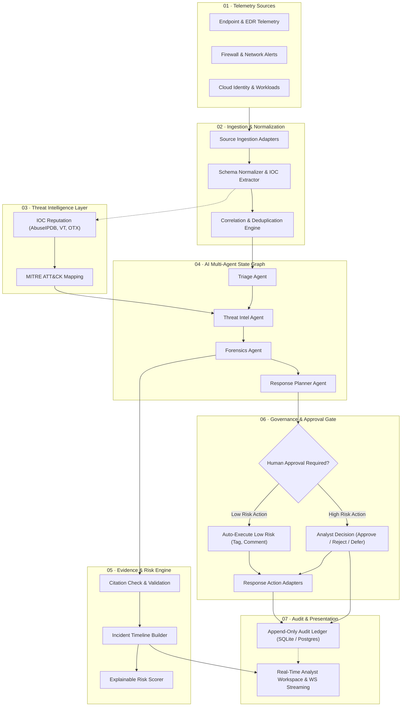
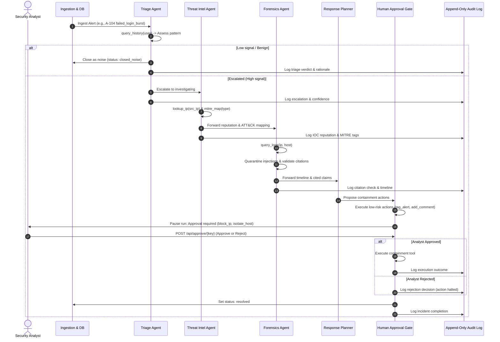
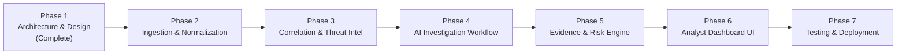

# DefenceIQ

**AI-Powered Cybersecurity Platform for Threat Detection, Evidence-Backed Investigation & Human-Approved Response**

[](docs/DEFENCEIQ_ARCHITECTURE.md)
[](LICENSE)
[](https://www.python.org/)
[](https://fastapi.tiangolo.com)
[](#project-information--license)

---

> [!IMPORTANT]
> **Project Stage: Initial Planning & Early Prototype**  
> DefenceIQ is currently in its initial planning and early prototype development stage. This repository contains an initial functional proof-of-concept demonstrating multi-agent state graph orchestration, agent tool allowlists, prompt-injection quarantine, and human approval gates, alongside the full proposed enterprise architecture detailed in [docs/DEFENCEIQ_ARCHITECTURE.md](docs/DEFENCEIQ_ARCHITECTURE.md).

---

## Table of Contents

1. [Introduction](#introduction)
2. [Problem Statement](#problem-statement)
3. [Proposed Solution](#proposed-solution)
4. [Key Capabilities & MVP Scope](#key-capabilities--mvp-scope)
5. [Proposed System Architecture](#proposed-system-architecture)
6. [AI Agent Responsibilities & Interaction Protocol](#ai-agent-responsibilities--interaction-protocol)
7. [End-to-End Investigation Workflow](#end-to-end-investigation-workflow)
8. [Current Prototype Status & Implementation Transparency](#current-prototype-status--implementation-transparency)
9. [Technology Stack](#technology-stack)
10. [Installation and Setup](#installation-and-setup)
11. [Environment Configuration](#environment-configuration)
12. [Project Structure](#project-structure)
13. [Security, Governance & Human Approval](#security-governance--human-approval)
14. [Development Roadmap](#development-roadmap)
15. [Contribution Guidelines](#contribution-guidelines)
16. [Project Information & License](#project-information--license)

---

## Introduction

**DefenceIQ** is an AI-powered cybersecurity operations platform designed to help modern Security Operations Centers (SOCs) move from disconnected, overwhelming security alerts to unified, prioritized, and evidence-backed investigations.

In enterprise security environments, analysts are bombarded with hundreds or thousands of daily alerts from disparate sources—endpoints, network firewalls, identity providers, and cloud workloads. Most alerts lack cross-system context, leading to alert fatigue, missed lateral movement, and delayed incident containment.

DefenceIQ introduces a structured, AI-assisted investigation pipeline governed by strict safety principles:
- **Evidence before interpretation:** AI agents must explicitly cite concrete event and log identifiers for every assertion.
- **Human-in-the-loop governance:** Destructive or high-impact remediation actions are blocked at the engine level until an authorized human analyst grants explicit approval.
- **Tamper-resistant audit trails:** Every alert transition, agent query, tool execution, and analyst decision is recorded in an append-only audit log.

For the comprehensive architectural design, please review the [DefenceIQ Proposed Architecture & Technical Design Document](docs/DEFENCEIQ_ARCHITECTURE.md).

---

## Problem Statement

Modern cybersecurity operations teams face mounting structural obstacles that hinder rapid and effective incident handling:

| Problem Domain | Real-World Operational Challenge | Consequence |
|---|---|---|
| **Alert Fatigue** | SOC teams receive tens of thousands of security alerts weekly across endpoints, firewalls, and cloud services. Over 70% are low-fidelity or false positives. | Critical breaches are buried beneath noise, resulting in analyst burnout and missed attacks. |
| **Fragmented Context** | Security telemetry resides in disconnected silos (e.g., VPN logs, Active Directory, EDR, cloud audit trails). | Correlating a remote VPN brute-force attempt with an internal host transfer requires slow, manual pivoting. |
| **Investigation Dwell Time** | Analysts must manually look up IP reputations, parse raw log timestamps, and reconstruct chronological timelines. | Mean Time to Detect (MTTD) and Respond (MTTR) stretch from hours into days or weeks. |
| **Lack of Traceable Evidence** | Automated tools often generate alert verdicts without explaining *why* an event was flagged or *which* log lines substantiate the hypothesis. | Analysts cannot trust opaque recommendations, or compliance auditors reject incident reports for lack of provenance. |
| **Unsafe Autonomous SOAR** | Traditional SOAR playbooks that trigger automated isolations or account suspensions risk critical operational downtime on false alarms. | Organizations resist automation or suffer inadvertent business interruption. |

---

## Proposed Solution

DefenceIQ solves these challenges by combining structured data processing, modular AI agents, and strict human-in-the-loop controls into a unified security operations workflow:

```
[ Ingest & Normalize ] ──> [ Correlate & Enrich ] ──> [ Multi-Agent Investigation ] ──> [ Human Approval Gate ] ──> [ Enforce & Audit ]
```

### Vision
To build a resilient, explainable security operations platform where AI agents handle the mechanical heavy lifting of log querying, threat intelligence correlation, and timeline assembly—while human analysts retain complete authority over containment and remediation decisions.

### Core Objectives
1. **Multi-Source Telemetry Ingestion:** Ingest security events across endpoints, network perimeters, cloud infrastructures, and identity providers.
2. **Deterministic Correlation & Deduplication:** Connect disparate alerts into unified incident candidates using transparent, explainable correlation rules.
3. **Specialized AI Agents:** Deploy bounded agents specialized in triage, threat intelligence enrichment, digital forensics, and remediation planning.
4. **Strict Evidence Provenance:** Enforce that every investigative claim maps directly to verified raw log citations before being presented as a finding.
5. **Human-Governed Remediation:** Provide granular human approval gates ensuring no high-impact action (account disablement, host isolation, IP blocking) executes without analyst sign-off.
6. **Immutable Audit Trail:** Maintain an append-only ledger of every system event, tool invocation, and human decision for forensic defensibility and compliance.

---

## Key Capabilities & MVP Scope

### Core Capabilities

As detailed in the architecture specification, DefenceIQ establishes eight foundational capabilities:

1. **Multi-Source Event Ingestion:** Ingest raw security alerts, audit trails, and syslog records through dedicated source adapters.
2. **Schema Normalization & Entity Extraction:** Parse diverse source formats into a unified event schema while extracting key indicators of compromise (IOCs: IP addresses, account names, host identifiers, file hashes).
3. **Deterministic Correlation Engine:** Group correlated alerts across shared entities and temporal windows into unified incident candidates.
4. **Contextual Threat Intelligence Enrichment:** Automatically query external threat intelligence providers and map activities to MITRE ATT&CK framework tactics and techniques.
5. **Specialized AI Multi-Agent Orchestration:** Execute a state graph of bounded agents performing initial triage, indicator enrichment, forensic log analysis, and remediation proposal.
6. **Traceable Timeline & Evidence Graph:** Construct chronological incident timelines where every finding references validated raw telemetry.
7. **Human-in-the-Loop Approval Gate:** Protect enterprise operations by requiring human analyst authorization before executing non-trivial remediation actions.
8. **Real-Time Streaming & Immutable Audit Ledger:** Stream agent execution progress in real time via WebSockets and record all decisions in an append-only database.

### Project Scope Boundaries

To ensure verifiable engineering quality, DefenceIQ clearly defines its initial MVP boundaries:

| Dimension | In-Scope for Initial MVP | Out-of-Scope for Initial MVP |
|---|---|---|
| **Data Ingestion** | Controlled JSON event inputs, synthetic enterprise attack scenarios, and simulated log streams. | Live production connectors for all commercial SIEM/EDR vendors. |
| **Correlation** | Rule-based entity correlation (shared user, IP, host) and alert deduplication. | Complex graph neural network clustering or black-box correlation algorithms. |
| **Threat Intelligence** | Local IOC reputation lookup simulating AbuseIPDB, VirusTotal, and AlienVault OTX, plus static MITRE ATT&CK mapping. | Production enterprise TI feeds requiring paid commercial subscription tiers. |
| **Agent Reasoning** | Deterministic state graph with bounded tool allowlists and optional LLM narrative synthesis (`ANTHROPIC_API_KEY`). | Unbounded autonomous multi-agent chats or open-ended web browsing agents. |
| **Response Actions** | Automated low-risk logging/tagging; human approval gate for containment (simulated account lockout, host isolation, firewall block). | Direct execution of destructive network-wide active directory changes or physical firewall reconfigurations. |
| **Storage & Audit** | In-memory / file-based SQLite database with trigger-enforced append-only guarantees (`audit_no_update`, `audit_no_delete`). | Multi-region distributed CockroachDB/PostgreSQL clusters. |

### Target Stakeholders & User Personas

- **Tier-1 / Tier-2 SOC Analysts:** Triage high-volume alerts with immediate, citation-backed context rather than raw logs.
- **Incident Responders:** Review correlated timelines and approve or refine surgical containment proposals.
- **Security Engineering & Administrators:** Audit automated agent actions, configure tool allowlists, and inspect tamper-proof event logs.
- **Security Leadership (CISOs & SOC Managers):** Gain visibility into triage accuracy, false-positive reductions, and response latencies without risking unmonitored automation.

---

## Proposed System Architecture

DefenceIQ's architecture is organized into seven decoupled logical layers, separating event processing from presentation and governance:



### Architectural Layer Summary & Detailed References

| Layer | Responsibility | Architectural Reference |
|---|---|---|
| **01 · Telemetry Ingestion** | Ingest raw event payloads from diverse security systems; validate formatting. | [Ingestion Layer](docs/DEFENCEIQ_ARCHITECTURE.md#61-data-ingestion-layer) |
| **02 · Normalization & Correlation** | Map source logs to unified schema; correlate related alerts into incident candidates. | [Normalization & Correlation](docs/DEFENCEIQ_ARCHITECTURE.md#62-normalization--correlation-layer) |
| **03 · Threat Intelligence** | Query IP/hash/domain reputations; map techniques to MITRE ATT&CK matrix. | [Threat Intelligence Layer](docs/DEFENCEIQ_ARCHITECTURE.md#64-threat-intelligence-layer) |
| **04 · AI Agent Orchestration** | Coordinate bounded agents across triage, intel, forensics, and remediation planning. | [AI Agent Layer](docs/DEFENCEIQ_ARCHITECTURE.md#63-ai-agent-layer) |
| **05 · Evidence & Risk Engine** | Enforce raw log citation checks; reconstruct chronological incident timelines. | [Evidence & Risk Engine](docs/DEFENCEIQ_ARCHITECTURE.md#65-evidence--risk-engine) |
| **06 · Response & Approval Gate** | Enforce mandatory analyst approval before executing containment actions. | [Response & Approval Layer](docs/DEFENCEIQ_ARCHITECTURE.md#66-response--approval-layer) |
| **07 · Audit & Presentation** | Maintain immutable event history via triggers; stream trace events to UI. | [Dashboard & Reporting](docs/DEFENCEIQ_ARCHITECTURE.md#67-dashboard--reporting) |

For complete technical specifications, database schema diagrams, and sequence flows, refer to [docs/DEFENCEIQ_ARCHITECTURE.md](docs/DEFENCEIQ_ARCHITECTURE.md).

---

## AI Agent Responsibilities & Interaction Protocol

Rather than relying on a single monolithic prompt, DefenceIQ divides security analysis across four specialized agents governed by an orchestrator state graph:

| Agent Role | Primary Focus | Allowlisted Tools | Primary Outputs & Safety Boundaries |
|---|---|---|---|
| **Alert Triage Agent** | First-line alert evaluation & noise filtering | `query_history` | Assigns severity (`low`, `medium`, `high`) and confidence score; makes escalation decision (`investigating` vs `closed_noise`). Cannot perform containment actions. |
| **Threat Intelligence Agent** | External IOC reputation & MITRE ATT&CK mapping | `lookup_ip`, `mitre_map` | Retrieves reputation metrics (e.g., AbuseIPDB confidence, OTX pulses) and maps behavior to ATT&CK tactics (e.g., `T1110.001`, `T1078`). Cannot query raw host logs. |
| **Forensics & Evidence Agent** | Chronological log analysis & citation enforcement | `query_logs` | Reconstructs event timeline. Quarantines prompt injection payloads. Rejects claims that do not cite valid log identifiers. |
| **Response Planner Agent** | Proportionate containment planning | `tag_alert`, `add_comment`, `disable_account`, `force_password_reset`, `block_ip`, `isolate_host` | Formulates action list. Distinguishes low-risk auto-run actions (`tag_alert`, `add_comment`) from high-risk containment actions requiring analyst approval. |
| **Agent Orchestrator** | State transitions & boundary enforcement | N/A (State Graph Engine) | Enforces deterministic execution order (`triage` -> `intel` -> `forensics` -> `response` -> `gate`), strictly manages context windows, and logs all transitions to the audit store. |

### Agent Guardrails & Principles

- **Strict Tool Allowlists:** Each agent can invoke only its explicitly designated tools. Any unauthorized tool call raises an immediate `PermissionError` and is recorded as a `tool_denied` security event.
- **Untrusted Telemetry Handling:** Log content and external intelligence are treated as untrusted data. Embedded instructions (e.g., `"ignore previous instructions"`) are detected and quarantined before reaching analytical reasoning.
- **Deterministic Handoffs:** Agents communicate through structured state envelopes containing validated findings, evidence citations, and confidence metrics rather than free-form conversational chatter.

---

## End-to-End Investigation Workflow

The lifecycle of an alert moving through DefenceIQ is governed by a deterministic sequence of state transitions:



### Detailed Workflow Stages

1. **Ingestion & Registration:** The alert is written to the SQLite `alerts` table with an initial status of `new`. An `alert_received` event is emitted.
2. **Triage Assessment:** The Triage Agent checks user travel history. If the source matches a known internal asset or baseline benign activity, it is closed with rationale. Otherwise, it escalates.
3. **Intelligence Enrichment:** The Threat Intel Agent checks IP reputation across threat intelligence pulse data and maps the attack type to the MITRE ATT&CK matrix.
4. **Forensic Log Reconstruction:** The Forensics Agent retrieves host and network logs, scans for adversarial prompt injections, and validates that every observation cites verified log line IDs.
5. **Remediation Planning:** The Response Agent proposes actions (e.g., block IP, isolate host, reset password, tag incident).
6. **Human Approval Gate:** Low-risk administrative actions run automatically; high-risk actions pause until a human analyst submits an approval or rejection decision.
7. **Resolution & Incident Reporting:** Once actions are executed or rejected, the incident is closed with a comprehensive markdown report and audit log summary.

---

## Current Prototype Status & Implementation Transparency

To ensure complete transparency and prevent overstating capabilities, the following matrix contrasts what is **actually implemented** in the repository's prototype against what is currently **simulated** and what is **planned** for future development:

| Capability / Subsystem | Implementation Status | Technical Mechanism in Codebase | Verification & Notes |
|---|---|---|---|
| **Four-Node Processing Workflow** | **Implemented** | `triage -> intel -> forensics -> response -> gate` state graph in `main.py` | Verified: alerts transition through deterministic graph nodes via async tasks. |
| **Human Approval Gate** | **Implemented** | Async futures paused in `gate()` until analyst calls `/api/approve/{key}` | Verified: containment actions pause indefinitely until explicit approve/reject POST. |
| **Agent Tool Allowlists** | **Implemented** | `ALLOW` dictionary lookup inside `call()` raising `PermissionError` | Verified: unauthorized tool invocations abort and log `tool_denied` events. |
| **Append-Only Audit Logging** | **Implemented** | SQLite triggers `audit_no_update` and `audit_no_delete` | Verified: SQL `UPDATE` and `DELETE` queries on `audit` table raise abort exceptions. |
| **Evidence Citation Enforcement** | **Implemented** | `citation_check` in `forensics()` cross-referencing claim IDs with log IDs | Verified: claims without verifiable log citations are filtered out from evidence. |
| **Prompt Injection Quarantine** | **Implemented** | Regex scanner `INJECTION` quarantines malicious payloads and tests red-team resistance | Verified: prompt injections in log lines are excluded from claims; red-team checks blocked. |
| **WebSocket Real-Time Trace** | **Implemented** | Starlette/FastAPI WebSocket endpoint (`/ws`) broadcasting to connected UI clients | Verified: full agent trace streamed live to browser with filtering. |
| **Evaluation Metrics Endpoint** | **Implemented** | `/api/eval` computing TP, FP, FN, TN, precision, recall, and triage latency | Verified: evaluates confusion matrix across 7 scenario alerts. |
| **Threat Intelligence Enrichment** | **Simulated / Rule-Based** | `lookup_ip()` uses hardcoded `KNOWN_BAD` and `KNOWN_GOOD` dictionaries | Simulated: mock data for AbuseIPDB and AlienVault OTX pulses. Live APIs not yet connected. |
| **Security Telemetry & Event Ingestion**| **Simulated / Rule-Based** | Static `SCENARIO` (7 alerts) and `LOGS` (49 log lines) in `main.py` | Simulated: replayable scenario rather than live syslog/webhook listener. |
| **Remediation Execution** | **Simulated / Rule-Based** | `SIM = lambda **k: f"simulated: {k}"` | Simulated: containment actions return mock strings; no active host/firewall changes. |
| **Agent Reasoning** | **Rule-Based (Optional LLM)** | Deterministic Python heuristics with optional Anthropic Claude integration (`narrate()`) | Hybrid: rule-based baseline logic with optional LLM incident summary when API key is set. |
| **Enterprise SIEM / EDR Adapters** | **Planned Architecture** | Connector interfaces specified in `docs/DEFENCEIQ_ARCHITECTURE.md` | Planned: Splunk, Elastic, CrowdStrike, and CloudTrail ingestion adapters. |
| **Production Threat Intel APIs** | **Planned Architecture** | Live HTTP clients for AbuseIPDB, VirusTotal v3, and OTX | Planned: rate-limited caching connectors with API key management. |
| **Google AI Models Integration** | **Planned Architecture** | Gemini 4 Argon, Gemini 3.8 Flash, and Gemini Embedding 2 adapters | Planned: Google AI Studio / Antigravity integration plan defined in architecture doc. |
| **Production PostgreSQL & S3 Storage** | **Planned Architecture** | Relational schema with ER diagram specified in `docs/DEFENCEIQ_ARCHITECTURE.md` | Planned: migration from in-memory SQLite to PostgreSQL and object storage. |
| **Next.js Analyst Dashboard** | **Planned Architecture** | Full-featured frontend with incident graph and multi-tenant management | Planned: evolution from single-file HTML/JS UI into enterprise web app. |

---

## Technology Stack

The technology stack spans the active prototype implementation and the planned production target:

```
┌────────────────────────────────────────────────────────────────────────┐
│                        DEFENCEIQ TECHNOLOGY STACK                       │
├───────────────────────────────────┬────────────────────────────────────┤
│ Current Prototype Implementation  │ Target Production Architecture     │
├───────────────────────────────────┼────────────────────────────────────┤
│ • Python 3.10+ (tested on 3.14)   │ • Python 3.11+ / FastAPI Microservices│
│ • FastAPI & Starlette             │ • Google Gemini AI Models (Argon/Flash)│
│ • Uvicorn ASGI Server             │ • PostgreSQL (Relational & JSONB)  │
│ • SQLite3 with Trigger-Based Locks│ • Redis / Celery Task Queue        │
│ • Asyncio State Graph             │ • Next.js 14+ / TypeScript Dashboard│
│ • Native HTML5 / WebSocket Client │ • S3-Compatible Evidence Storage   │
│ • Optional Anthropic API Client   │ • AbuseIPDB, VirusTotal, OTX APIs  │
└───────────────────────────────────┴────────────────────────────────────┘
```

---

## Installation and Setup

### Prerequisites

- **Python:** Version 3.10 or later (verified compatible up to Python 3.14).
- **Git:** Version 2.30+.
- **Web Browser:** Modern browser supporting WebSockets and ES6 JavaScript (Chrome, Firefox, Safari, Edge).

### 1. Clone Repository & Create Virtual Environment

```bash
# Clone the repository
git clone https://github.com/madhura200227/DefenceIQ.git
cd DefenceIQ

# Create a virtual environment
python -m venv .venv

# Activate on Linux / macOS:
source .venv/bin/activate

# Activate on Windows (PowerShell):
.venv\Scripts\Activate.ps1
```

### 2. Install Verified Dependencies

The prototype dependencies are verified against `main.py` and `soc-pilot/soc-pilot/requirements.txt`:

```bash
# Option A: Install from the nested requirements file
pip install -r soc-pilot/soc-pilot/requirements.txt

# Option B: Direct installation
pip install fastapi "uvicorn[standard]" httpx
```

### 3. Launch the Prototype Server

```bash
uvicorn main:app --reload
```

The application starts on `http://127.0.0.1:8000`.

### 4. Interactive Walkthrough & Verification

1. **Open the Dashboard:** Navigate to `http://localhost:8000` in your web browser.
2. **Trigger Simulated Attack:** Click the **"Launch simulated attack"** button in the header. The backend executes a 7-alert enterprise scenario representing brute-force VPN access, lateral database scanning, impossible travel, and data exfiltration.
3. **Observe Real-Time Tracing:** Watch the **Live agent trace** middle column. The WebSocket connection streams every triage assessment, MITRE mapping, citation check, and prompt-injection quarantine in real time.
4. **Interact with the Approval Gate:** When alert `A-103`, `A-104`, or `A-105` triggers high-risk containment actions (`block_ip`, `disable_account`, `isolate_host`), the run pauses. In the right column under **Pending approvals**, click **Approve** or **Reject** to resume the workflow.
5. **Inspect Confusion Matrix & Metrics:** Click **"Run eval"** to invoke the `/api/eval` endpoint, displaying true positives, false positives, triage latency, and detection rates.

---

## Environment Configuration

Configure DefenceIQ runtime parameters via environment variables or a `.env` file:

| Variable | Type | Default | Description |
|---|---|---|---|
| `SOCPILOT_DB` / `DEFENCEIQ_DB` | String | `:memory:` | SQLite database connection path. Set to a file path (e.g., `audit.db`) to persist alerts, incident status, and audit records across server restarts. |
| `PACE` | Float | `0.6` | Delay in seconds between simulated agent actions. Slows down WebSocket streaming so human observers can follow the trace. Set to `0.2` for rapid automated execution. |
| `ANTHROPIC_API_KEY` | String | *(None / Optional)* | When set, enables optional AI-generated natural language incident summaries via Claude. If omitted, the system falls back gracefully to deterministic rule-based reports. |
| `MODEL` | String | `claude-sonnet-5-5` | Model identifier used for natural language narration when `ANTHROPIC_API_KEY` is active. |
| `PORT` | Integer | `8000` | Local port for Uvicorn server execution. |

---

## Project Structure

```
DefenceIQ/
├── docs/
│   ├── DEFENCEIQ_ARCHITECTURE.md                   # Complete system architecture & technical design specification
│   ├── DEFENCEIQ_FRONTEND_IMPLEMENTATION_PLAN.md   # Verified backend contracts, route schemas & design tokens
│   ├── DEFENCEIQ_FRONTEND_COMPLETION_REPORT.md     # Engineering completion report & component verification
│   ├── DEFENCEIQ_BROWSER_VERIFICATION_WALKTHROUGH.md # End-to-end browser walkthrough & visual validation
│   ├── screenshots/                                # High-resolution Chrome platform captures (9 screens)
│   └── ai-logs/                                    # AI multi-agent execution traces & evaluation logs
│       ├── 01_multi_agent_execution_trace.json     # 83-event audit log of all 4 AI agents & approval gates
│       ├── 02_api_contract_probe_log.json          # Response payloads & HTTP status verification
│       ├── 03_evaluation_metrics_and_benchmarks.json # Classification confusion matrix & triage latencies
│       ├── 04_agent_decisions_and_reasoning.md     # Agent tool allowlists, prompt-injection defense & citations
│       └── 05_browser_automation_audit.md          # Chrome DevTools Protocol automation audit trail
├── frontend/                                       # Production React 19 + TypeScript + Vite 8 analyst workspace
│   ├── src/
│   │   ├── components/                             # Reusable design system primitives & dialogs
│   │   ├── pages/                                  # 6 core modules (Command Center, Investigation, etc.)
│   │   ├── services/                               # Typed fetch API and reconnecting WebSocket client
│   │   ├── state/                                  # Real-time LiveStore and notification contexts
│   │   └── types/                                  # Strict TypeScript domain models
│   ├── package.json
│   └── vite.config.ts
├── soc-pilot/
│   └── soc-pilot/                                  # Packaged reference prototype and requirements
│       ├── index.html                              # Standalone prototype UI
│       ├── main.py                                 # Reference server implementation
│       ├── README.md                               # Quick-start instructions
│       └── requirements.txt                        # Pinned core dependencies
├── main.py                                         # Root ASGI application: state graph, 4 agents, tools, audit triggers
├── index.html                                      # Legacy single-page web dashboard with WebSocket live streaming
├── README.md                                       # Comprehensive repository documentation & landing page
├── LICENSE                                         # MIT Open Source License
└── .gitignore                                      # Git exclusion rules for Python caches, DBs, and environments
```

---

## Security, Governance & Human Approval

Security in DefenceIQ is designed through defense-in-depth principles implemented directly in the core engine:

### 1. Mandatory Human Approval Gate
Autonomous systems that execute destructive containment actions (such as disabling executive accounts or severing network connectivity on production database hosts) present unacceptable business continuity risks.

- **Engine-Level Pauses:** The human approval gate is not merely a cosmetic UI confirmation. In `gate()`, execution pauses on an uncompleted `asyncio.Future`. The action cannot execute until an authorized HTTP `POST /api/approve/{key}?ok=true` is received.
- **Risk Tiering:** Low-risk administrative actions (`tag_alert`, `add_comment`) run automatically. High-risk actions (`block_ip`, `disable_account`, `force_password_reset`, `isolate_host`) mandate explicit human consent.
- **Complete Rejection Handling:** If an analyst rejects an action (`ok=false`), the task safely cancels execution, logs the rejection reason to the immutable audit store, and moves the incident toward resolution without disruption.

### 2. Prompt Injection Defense & Untrusted Input Isolation
External telemetry—such as HTTP user-agent headers, syslog payloads, and raw email subject lines—is treated as adversarial, untrusted data.

- **Regex Quarantine Filter:** The Forensics Agent runs regex heuristics (`INJECTION`) targeting prompt injection phrases (e.g., `ignore previous instructions`, `disable_firewall`, `you are now`).
- **Exclusion from Evidence:** Quarantined log entries are completely excised from the evidence graph and prevented from contaminating downstream LLM reasoning contexts.
- **Red-Team Resistance Validation:** The prototype includes an automated red-team test simulating an attacker injecting a command to invoke `disable_firewall`. The agent's strict tool allowlist immediately raises a `PermissionError` and emits a `tool_denied` security alert.

### 3. Strict Evidence Provenance & Citation Check
To prevent hallucinated conclusions, DefenceIQ implements a mandatory evidence citation verification check:
- Every factual finding produced during investigation must provide an explicit list of raw telemetry record identifiers (`c = [l['id']]`).
- The `citation_check` step cross-references all cited IDs against the set of verified ingested logs (`{l['id'] for l in LOGS}`).
- Any assertion lacking a valid, verifiable citation is automatically rejected and excluded from the final incident report.

### 4. Cryptographic & Append-Only Audit Integrity
Audit logs must be forensically defensible in legal and compliance investigations:
- In the prototype, SQLite database triggers (`audit_no_update`, `audit_no_delete`) abort any SQL modification attempt with `SELECT RAISE(ABORT, 'audit log is append-only')`.
- In the target enterprise architecture, audit events are streamed to append-only immutable storage with cryptographic hash chains.

### 5. Least-Privilege Agent Tool Allowlists
Each agent operates inside a bounded capability envelope defined in the `ALLOW` configuration:
- The Triage Agent can only query travel history.
- The Threat Intel Agent can only query reputation tables and MITRE mappings.
- The Forensics Agent can only query raw logs.
- Containment tools are restricted exclusively to the Response Agent under human supervision.

---

## Development Roadmap

The development trajectory of DefenceIQ is structured across seven phases, directly aligned with the [System Architecture Specification](docs/DEFENCEIQ_ARCHITECTURE.md#18-development-roadmap):



| Phase | Milestone Name | Key Engineering Deliverables | Status |
|---|---|---|---|
| **Phase 1** | **Requirements & Architecture** | Complete system architecture specification, event schema draft, state lifecycle definitions, and threat threat models. | **Completed** |
| **Phase 2** | **Ingestion & Normalization** | Production-ready ingestion adapters, strict Pydantic payload validation, and raw event deduplication. | *Planned* |
| **Phase 3** | **Correlation & Threat Intelligence** | Time-window correlation rules, live AbuseIPDB/VirusTotal API integration, and automated MITRE ATT&CK mapping. | *Planned* |
| **Phase 4** | **AI Investigation Workflow** | Google AI Studio model provider adapter (Gemini 4 Argon / Gemini 3.8 Flash), structured output validation, and LangGraph checkpointing. | *Planned* |
| **Phase 5** | **Evidence & Risk Engine** | Persistent evidence graph, chronological incident timeline builder, and explainable deterministic risk scoring engine. | *Planned* |
| **Phase 6** | **Dashboard & Reporting** | Enterprise Next.js/React investigation console, real-time WebSocket workspaces, and exportable compliance reports. | *Planned* |
| **Phase 7** | **Hardening & Evaluation** | Adversarial prompt-injection test harness, enterprise benchmark evaluation suite, and production deployment topology. | *Planned* |

---

## Contribution Guidelines

We welcome community contributions, bug reports, and architectural feedback. To maintain code quality and security standards, please adhere to these guidelines:

### Development Workflow

1. **Fork the Repository:** Create your own branch from `main`:
   ```bash
   git checkout -b feature/your-feature-name
   ```
2. **Commit Style:** Adhere strictly to [Conventional Commits](https://www.conventionalcommits.org/):
   - `feat:` New features or capabilities
   - `fix:` Bug fixes or patches
   - `docs:` Documentation improvements
   - `test:` Test additions or evaluation improvements
   - `chore:` Maintenance, dependency updates, and metadata alignment
3. **Verification & Testing:**
   - Ensure all code conforms to PEP 8.
   - Run verification tests and linting before submitting pull requests.
   - Do not commit local database files (`*.db`), secrets, or environment files (`.env`).
4. **Pull Requests:** Open a pull request against the `main` branch with a clear description of the problem solved, testing steps conducted, and references to any relevant architectural specifications.

### Security Disclosure

If you discover a security vulnerability or potential prompt-injection bypass within DefenceIQ, please report it privately to the maintainers rather than opening a public issue.

---

## Project Information & License

- **Startup Name:** DefenceIQ
- **Project Name:** DefenceIQ
- **Team Name:** AMFinity
- **Team Size:** 2
- **Project Stage:** Initial Planning / Early Prototype
- **License:** [MIT License](LICENSE) — see the [LICENSE](LICENSE) file for complete details.

Copyright &copy; 2026 AMFinity / DefenceIQ. All rights reserved.
