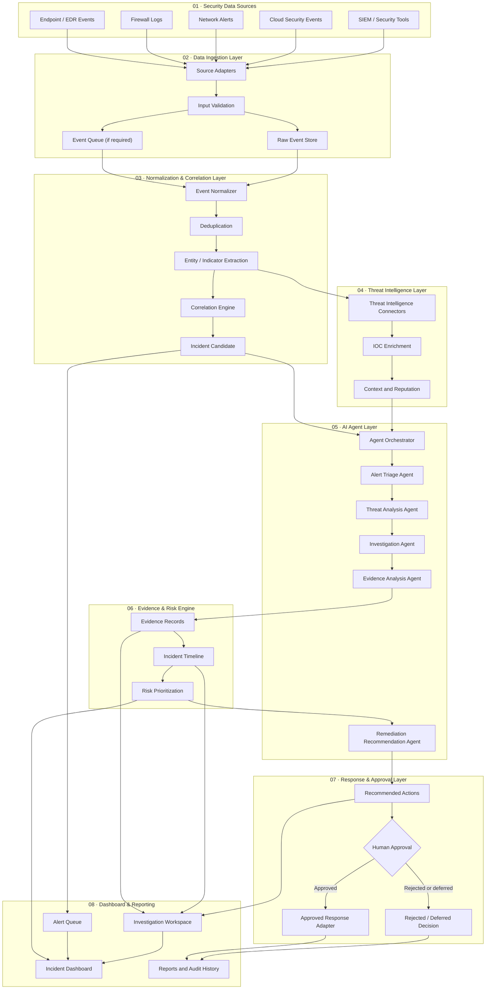
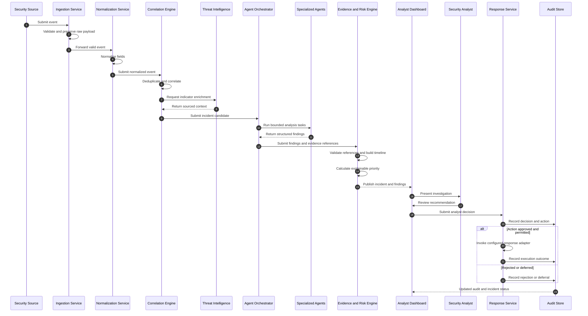
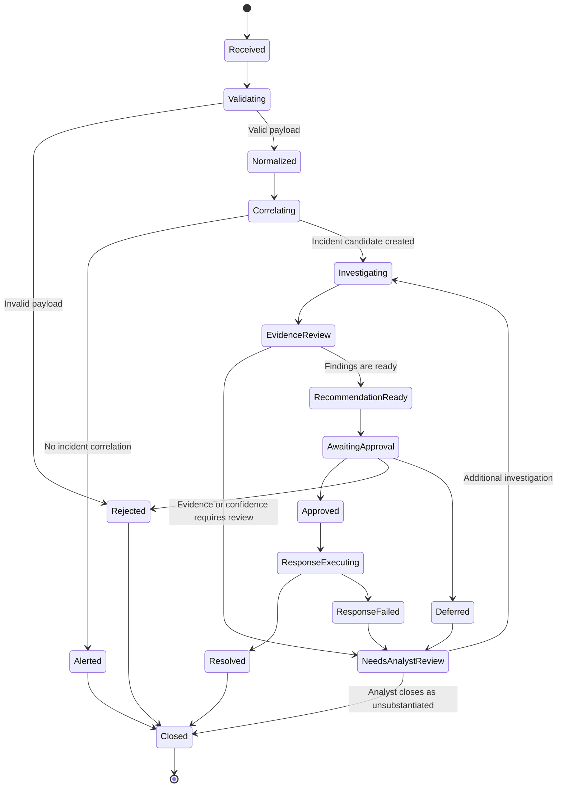
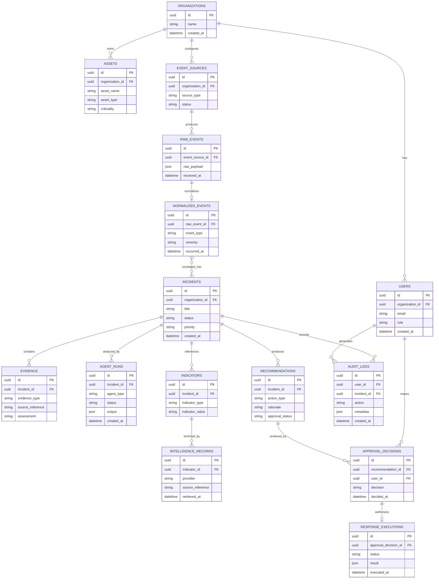
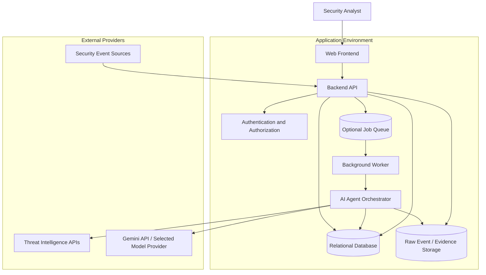

# DefenceIQ — Proposed System Architecture & Technical Design

**Document type:** System Architecture and Technical Design Document  
**Project / startup name:** DefenceIQ  
**Team:** AMFinity  
**Team size:** 2  
**Project stage:** Initial planning and design  
**Version:** 0.1  
**Status:** Proposed architecture — implementation not yet started  
**Source of product requirements:** Startup Buildathon presentation supplied by the team

---

## Document Status and Interpretation

DefenceIQ is at the initial planning stage. The project has not yet been implemented. This document therefore describes a **proposed architecture**, not a reverse-engineered description of existing software.

The document distinguishes:

- **PPT-defined:** Capabilities and technology choices explicitly described in the team's presentation.
- **Proposed design:** Engineering decisions suggested to turn the concept into an implementable system.
- **To be confirmed:** Decisions that require team agreement, technical experiments, or validation against competition requirements.

No implementation, integration, model performance, security certification, or deployment is claimed by this document.

## 1. Product Overview

### 1.1 Product Identity

**DefenceIQ** is an AI-powered cybersecurity platform intended to support threat detection, investigation, and incident response.

### 1.2 Product Vision

Build a unified security operations platform that helps security teams move from disconnected alerts to prioritized, evidence-backed investigations and controlled response recommendations.

### 1.3 Core Value Proposition

Security teams often receive large volumes of alerts from endpoint, network, firewall, cloud, and security monitoring systems. DefenceIQ aims to correlate related events, enrich them with threat intelligence, use specialized AI agents to support investigation, and present explainable recommendations to human analysts.

### 1.4 Core Capabilities

As described in the team's presentation:

1. Collect security alerts and logs from multiple environments.
2. Normalize and correlate related security events.
3. Use specialized AI agents for alert triage, threat analysis, investigation, and remediation recommendations.
4. Enrich investigations with threat intelligence.
5. Build incident timelines and preserve supporting evidence.
6. Prioritize risks.
7. Require human approval for critical response actions.
8. Provide dashboard visibility and reporting.

## 2. Problem Statement

Modern organizations receive security alerts from firewalls, endpoints, cloud platforms, networks, and security monitoring tools. Security teams may struggle to distinguish genuine threats from false positives and to investigate related events across disconnected systems.

This can contribute to:

- Alert fatigue.
- Fragmented investigation context.
- Delayed incident analysis.
- Missed relationships between security events.
- Inconsistent response decisions.
- Limited traceability from an alert to the evidence supporting a conclusion.

DefenceIQ proposes a unified workflow for collecting, correlating, investigating, and responding to security incidents with AI assistance and human oversight.

## 3. Objectives and Scope

### 3.1 Primary Objectives

- Ingest security events from supported sources.
- Validate and normalize incoming events.
- Correlate related alerts into investigation candidates.
- Enrich indicators and events with threat intelligence.
- Use specialized AI agents to assist triage and investigation.
- Preserve evidence and construct incident timelines.
- Prioritize incidents using explainable risk factors.
- Recommend response actions.
- Keep critical response actions subject to human approval.
- Present incident status, evidence, and recommendations through a dashboard.

### 3.2 Initial MVP Scope — Proposed

The first usable version should focus on a narrow, demonstrable vertical slice:

1. Accept events from one or two controlled input sources (for example, sample JSON events or a selected log integration).
2. Validate and normalize those events into one internal event schema.
3. Apply basic deduplication and rule-based correlation.
4. Enrich supported indicators using one selected threat-intelligence source or a local test dataset.
5. Run an alert-triage and investigation workflow.
6. Store findings with references to their source events.
7. Produce a risk-prioritized incident record and remediation recommendation.
8. Present the incident and its evidence in a basic dashboard.
9. Record an analyst approval, rejection, or deferral decision.

This MVP scope is a recommendation. The team should select actual integrations only after checking access, API limits, licensing, and implementation effort.

### 3.3 Out of Scope for the First MVP — Proposed

- Autonomous execution of destructive or high-impact security actions.
- Guaranteed detection of all attack types.
- Replacement of a full SIEM, EDR, or SOC platform.
- Unbounded multi-agent conversations.
- Unsupported claims of real-time coverage across every security vendor.
- Production-grade integrations with every source listed in the product vision.

## 4. Stakeholders and Users

### Primary users

- Security analysts.
- Security operations centre (SOC) teams.
- Incident responders.
- Security administrators.

### Secondary users

- IT operations teams.
- Security managers.
- Organizations seeking consolidated incident visibility.

### Main user goals

- Understand which alerts deserve attention.
- See why an event was prioritized.
- Review evidence and related events in one place.
- Understand the likely threat context.
- Review and approve proposed response actions.
- Audit what the system and analyst decided.

## 5. High-Level System Architecture

### 5.1 Architecture Overview

The proposed system is organized into the following logical layers:

1. **Data Ingestion Layer** — receives events from security sources.
2. **Normalization & Correlation Layer** — standardizes events and connects related alerts.
3. **AI Agent Layer** — performs triage, threat analysis, investigation, evidence analysis, and remediation recommendation.
4. **Threat Intelligence Layer** — enriches events and indicators with contextual intelligence.
5. **Evidence & Risk Engine** — records evidence, builds timelines, and prioritizes incidents.
6. **Response & Approval Layer** — presents recommended actions and enforces human approval for critical operations.
7. **Dashboard & Reporting** — presents alerts, investigations, incident status, and reports.

The dashboard is a presentation layer that consumes information from the backend services; it is not a substitute for the underlying processing pipeline.

### 5.2 Mermaid — Proposed System Architecture



**Design note:** The event queue is optional in the first implementation. Introduce it when ingestion volume, asynchronous processing, retries, or source reliability justify the operational complexity.

## 6. Component-Level Architecture

### 6.1 Data Ingestion Layer

**Purpose:** Receive security events from external systems or controlled test inputs.

**Responsibilities:**

- Provide a separate adapter for each supported event source.
- Authenticate with external systems where required.
- Validate payload structure and required fields.
- Attach source metadata and ingestion timestamps.
- Preserve the original event payload for traceability.
- Handle malformed input and connector failures.

**Input:** Source-specific logs, alerts, or event payloads.

**Output:** Validated raw event records.

**Proposed design:** Define a connector interface so new integrations can be added without changing the downstream event-processing contract.

### 6.2 Normalization & Correlation Layer

**Purpose:** Convert different source formats into a consistent internal representation and identify related events.

**Responsibilities:**

- Normalize timestamps and common field names.
- Standardize severity and event categories.
- Extract available entities and indicators.
- Deduplicate repeated events.
- Correlate events using explicit, explainable rules.
- Create an incident candidate when correlation conditions are met.

**Input:** Validated raw events.

**Output:** Normalized events and correlated incident candidates.

**Important distinction:** Correlation indicates a possible relationship. It does not by itself prove malicious activity.

### 6.3 AI Agent Layer

**Purpose:** Coordinate specialized AI-assisted analysis tasks.

**Proposed agent responsibilities:**

| Agent | Responsibility | Expected output |
|---|---|---|
| Alert Triage Agent | Classify and prioritize an alert using available context | Category, priority rationale, uncertainty |
| Threat Analysis Agent | Analyze indicators and contextual threat information | Threat hypotheses and supporting references |
| Investigation Agent | Organize related events and identify investigation questions | Investigation findings and timeline candidates |
| Evidence Analysis Agent | Check whether findings are supported by source records | Evidence references, gaps, conflicting observations |
| Remediation Recommendation Agent | Suggest proportionate response options | Recommended actions, rationale, impact and approval requirement |

**Agent Orchestrator responsibilities:**

- Start agents in a controlled order.
- Pass only the context required for each task.
- Validate structured agent outputs.
- Track execution state and errors.
- Apply timeouts and bounded retries.
- Prevent an agent from treating untrusted event text as instructions.
- Preserve agent outputs for audit and review.

**Important:** These are proposed logical agents. They do not need to be separate deployed services or separate models. A single model with task-specific prompts and schemas may be sufficient for the MVP.

### 6.4 Threat Intelligence Layer

**Purpose:** Add external or locally maintained context to indicators and events.

**Potential enrichment categories:**

- Indicator reputation.
- Known malicious or suspicious indicators.
- Threat actor or campaign context, where reliably sourced.
- Related reports or intelligence references.
- First-seen and last-seen information, when available.

**Responsibilities:**

- Query selected intelligence providers.
- Normalize provider responses.
- Record source and retrieval time.
- Preserve the distinction between provider data and AI interpretation.
- Handle unavailable providers and rate limits.

**To be confirmed:** Select providers only after checking their API terms, data coverage, quotas, and permitted use.

### 6.5 Evidence & Risk Engine

**Purpose:** Make investigation conclusions traceable and support consistent prioritization.

**Evidence record should contain:**

- Evidence ID.
- Related incident ID.
- Source event ID or external reference.
- Evidence type.
- Observed value or summarized observation.
- Source system.
- Event timestamp and collection timestamp.
- Supporting or contradictory relationship.
- Provenance metadata.

**Risk prioritization should consider:**

- Event severity.
- Confidence in the observation.
- Asset or account context, if available.
- Threat-intelligence context.
- Number and relationship of supporting events.
- Potential business impact, if supplied by the organization.

The MVP should use a documented, deterministic baseline scoring policy before relying on an opaque AI-generated score. The score must be explainable and must not be presented as a mathematically calibrated probability unless calibration has been measured.

### 6.6 Response & Approval Layer

**Purpose:** Turn investigation findings into controlled response decisions.

**Responsibilities:**

- Display proposed response actions.
- Explain why an action is recommended.
- Identify expected operational impact.
- Mark whether approval is required.
- Record analyst identity, decision, timestamp, and comments.
- Execute only actions permitted by configured policy and authorization.
- Record execution result or failure.

**Safety boundary:** Critical response actions must remain behind explicit human approval. The initial MVP should prefer recommendations and simulated/test response adapters over autonomous changes to production systems.

### 6.7 Dashboard & Reporting

**Proposed views:**

- Alert queue with priority and status.
- Incident overview.
- Investigation workspace.
- Evidence and event timeline.
- Threat-intelligence context.
- Recommended response actions.
- Approval history.
- Incident reports and audit history.

The dashboard should distinguish raw observations, external intelligence, AI-generated hypotheses, and analyst-approved conclusions.

## 7. End-to-End Workflows

### 7.1 Main Incident Workflow

1. A supported source sends a security event.
2. The ingestion adapter validates the payload and stores the original record.
3. The normalization service maps the event into the internal schema.
4. Deduplication and correlation logic identify related events.
5. The threat-intelligence layer enriches supported indicators.
6. The orchestrator starts the appropriate AI-assisted analysis tasks.
7. Agents return structured findings with references to available evidence.
8. The evidence engine records findings and builds an incident timeline.
9. The risk engine calculates a documented priority.
10. The remediation agent proposes response options.
11. A human analyst approves, rejects, or defers a critical action.
12. Any permitted response outcome and the decision history are recorded.
13. The dashboard displays the updated incident state.

### 7.2 Mermaid — End-to-End Sequence Diagram



### 7.3 Mermaid — Incident State Lifecycle



The exact states and transition rules should be finalized during backend design. For example, an alert that is not correlated into an incident may still remain visible in the alert queue.

## 8. AI Agent Interaction Protocol

### 8.1 Proposed Execution Order

1. **Independent input preparation:** Collect the normalized event, related events, and sourced enrichment.
2. **Triage:** Determine event category, priority rationale, and whether further investigation is warranted.
3. **Threat analysis:** Generate threat hypotheses and cite relevant indicators or event references.
4. **Investigation:** Organize the available context and identify missing information.
5. **Evidence analysis:** Check that findings map to source records and identify unsupported claims.
6. **Remediation recommendation:** Suggest proportionate options based on the validated findings.
7. **Human review:** Present the recommendation for an authorized decision.

### 8.2 Structured Agent Output

A proposed common response envelope:

```json
{
  "task_id": "task_123",
  "incident_id": "incident_123",
  "agent_type": "threat_analysis",
  "status": "completed",
  "summary": "Short analysis summary",
  "findings": [
    {
      "finding": "Observed behavior requiring investigation",
      "evidence_refs": ["evidence_001"],
      "confidence_label": "medium"
    }
  ],
  "uncertainties": ["Additional telemetry is required"],
  "recommended_next_step": "Review the referenced source events"
}
```

This is an internal proposed schema, not an existing API contract.

### 8.3 Agent Guardrails

- Agents must not invent event fields, evidence, or intelligence sources.
- Each factual finding should reference available evidence or be explicitly marked as a hypothesis.
- External document, log, and event content must be treated as untrusted data, not instructions.
- Agent outputs must be schema-validated.
- Execution must have timeouts, bounded retries, and token or cost limits.
- Critical response actions must not be executed solely because an AI agent recommended them.
- The system must preserve the original source record and the generated interpretation separately.

## 9. Data Architecture

### 9.1 Proposed Logical Data Model

The following entities are a starting point for database design:

| Entity | Purpose | Important relationships |
|---|---|---|
| users | Authenticated platform users | Own or access incidents according to policy |
| organizations | Tenant or organization boundary | Has users, assets, and incidents |
| assets | Systems or resources being monitored | Referenced by events and incidents |
| event_sources | Configured event integrations | Produces events |
| raw_events | Original received payloads | Belongs to a source |
| normalized_events | Standardized event records | References a raw event |
| incidents | Correlated investigation records | Groups events, findings, and decisions |
| indicators | Extracted IPs, domains, hashes, or other supported indicators | Linked to events and enrichment |
| intelligence_records | Sourced enrichment results | References provider and indicator |
| evidence | Traceable observations supporting or challenging findings | Belongs to an incident |
| agent_runs | Agent execution metadata and outputs | Belongs to an incident |
| recommendations | Suggested response actions | Belongs to an incident |
| approval_decisions | Analyst approval, rejection, or deferral | References a recommendation and user |
| response_executions | Result of an approved response adapter | References an approved recommendation |
| audit_logs | Append-oriented record of important actions | References relevant users and objects |

### 9.2 Mermaid — Proposed Entity Relationship Diagram



**Database choice:** Not specified in the presentation. PostgreSQL is a reasonable proposed starting point for relational incident data, audit records, and JSON event payloads. The team should confirm the database after evaluating query patterns, hosting, retention, and access-control requirements.

### 9.3 Data Management Principles

- Keep raw source payloads separate from normalized records.
- Preserve provenance for every enrichment result and evidence item.
- Use tenant or organization boundaries in every relevant query.
- Define retention and deletion policies for raw security telemetry.
- Restrict access to sensitive event data.
- Avoid storing secrets or credentials in event payloads longer than necessary.
- Record timestamps in a consistent UTC representation.
- Index common incident, source, severity, and time-range queries.

## 10. Proposed API Architecture

The API contract is not defined in the presentation. The following REST endpoints are a starting proposal and should be revised after selecting the backend framework and authentication approach.

| Method | Endpoint | Purpose |
|---|---|---|
| POST | `/api/v1/events/ingest` | Accept an event from an authorized source |
| GET | `/api/v1/events` | List normalized events |
| GET | `/api/v1/incidents` | List incidents with filters |
| POST | `/api/v1/incidents` | Create an incident manually or through a controlled workflow |
| GET | `/api/v1/incidents/:id` | Retrieve incident details |
| GET | `/api/v1/incidents/:id/evidence` | Retrieve evidence records |
| GET | `/api/v1/incidents/:id/timeline` | Retrieve incident timeline |
| GET | `/api/v1/incidents/:id/analysis` | Retrieve analysis and agent run summaries |
| GET | `/api/v1/incidents/:id/recommendations` | Retrieve remediation recommendations |
| POST | `/api/v1/recommendations/:id/decision` | Submit approve, reject, or defer decision |
| GET | `/api/v1/audit-logs` | Retrieve authorized audit history |

### API Design Requirements

- Validate all request bodies and query parameters.
- Authenticate callers and authorize each resource operation.
- Apply rate limits to externally accessible ingestion endpoints.
- Use pagination for list endpoints.
- Return consistent error structures.
- Use idempotency controls for event ingestion where practical.
- Do not expose provider credentials or model API keys to the frontend.
- Do not allow a client-side role or request field to bypass approval policy.

## 11. Google AI Technology Plan

The presentation identifies the following tools and model names as planned choices. Their suitability and availability must be verified before implementation.

### 11.1 Google AI Tools

| Tool | Intended use in DefenceIQ |
|---|---|
| Google AI Studio | Prototype, test, and integrate Gemini models through the Gemini API |
| Google Antigravity | AI-assisted development, testing, and coordination of implementation work |
| Google Agent Skills | Reusable task-specific instructions and workflows for specialized agents |

### 11.2 Models Listed in the Presentation

| Model name as written in PPT | Intended responsibility |
|---|---|
| Gemini 4 Argon | Complex threat analysis, multi-step reasoning, investigation planning, and decision support |
| Gemini 3.8 Flash | Fast alert classification, threat summarization, prioritization, and routine agent tasks |
| Gemini Embedding 2 | Semantic search and retrieval of related incidents, intelligence, and evidence |

**Verification required:** These exact model identifiers and their availability, API names, capabilities, and access must be checked in the official Google AI documentation before the team commits to them. This document preserves the names from the supplied presentation; it does not independently verify them.

### 11.3 Model Integration Design

Create a model-provider adapter rather than coupling business logic directly to one model identifier.

The adapter should define:

- Model configuration.
- Request and response schemas.
- Timeout and retry policy.
- Token or usage tracking, where available.
- Error mapping.
- Structured output validation.
- Provider-specific logging with sensitive data redaction.

This allows the team to change models without redesigning the incident workflow.

## 12. Threat Intelligence and Retrieval Design

### 12.1 Enrichment Flow

1. Extract supported indicators from normalized events.
2. Validate indicator format.
3. Query configured intelligence providers or a local test dataset.
4. Normalize returned intelligence.
5. Store provider, source reference, and retrieval timestamp.
6. Attach enrichment to the relevant incident.
7. Make sourced context available to the investigation agents.

### 12.2 Retrieval Considerations

Semantic embeddings may help retrieve related incident descriptions or intelligence documents. Retrieval should not be treated as proof that two events are related.

For each retrieved result, retain:

- Original source reference.
- Retrieval timestamp.
- Similarity or relevance metadata, if applicable.
- Exact passage or record used.
- Whether the information is current or potentially stale.

## 13. Evidence, Risk, and Explainability

### 13.1 Evidence Categories

Proposed evidence classifications:

- Direct observation.
- Correlated observation.
- External intelligence.
- Supporting evidence.
- Contradictory evidence.
- Unverified claim.
- Missing information.

### 13.2 Evidence Traceability

Every significant investigation finding should point to one or more source event IDs, evidence IDs, or intelligence references.

The system should make it possible for an analyst to answer:

- What was observed?
- Which source reported it?
- When was it observed?
- Which incident is it associated with?
- Is it an observation, an external claim, or an AI hypothesis?
- What supports or contradicts the conclusion?

### 13.3 Risk Prioritization

Use a transparent, configurable baseline rather than an unexplained AI score.

Potential inputs include:

- Source severity.
- Asset criticality, if available.
- Evidence strength.
- Correlation context.
- Threat-intelligence context.
- Potential operational impact.

The scoring formula, weights, thresholds, and validation method remain to be designed and tested. Do not describe the resulting score as a probability of compromise unless it has been calibrated and validated for that interpretation.

## 14. Security and Governance

### 14.1 Application Security

- Use authenticated access and role-based authorization.
- Enforce organization-level data isolation.
- Store secrets in server-side environment or secret-management facilities.
- Encrypt data in transit and use suitable encryption at rest.
- Validate and sanitize all external inputs.
- Apply rate limits and request-size limits.
- Log security-relevant actions.
- Restrict access to sensitive incident evidence.

### 14.2 AI Security

- Treat logs, alerts, documents, and external intelligence as untrusted input.
- Do not follow instructions embedded in untrusted event content.
- Separate system instructions from retrieved data.
- Validate model output against strict schemas.
- Require evidence references for factual claims.
- Mark unsupported conclusions as hypotheses or unknowns.
- Limit agent tools and permissions to the minimum required.
- Prevent agents from directly bypassing approval controls.

### 14.3 Human Approval

The system should enforce approval in backend policy, not merely hide an execution button in the frontend.

For each approval decision, record:

- Recommendation ID.
- Analyst identity.
- Decision: approved, rejected, or deferred.
- Decision timestamp.
- Analyst comments.
- Policy or authorization context.
- Execution result, if an action was approved and executed.

## 15. Reliability and Operational Requirements

Proposed non-functional requirements:

### Reliability

- Gracefully handle unavailable event sources and intelligence providers.
- Use bounded retries for transient failures.
- Make event ingestion idempotent where possible.
- Preserve failed processing records for investigation.
- Avoid losing original source events when downstream analysis fails.

### Performance

- Keep ingestion separate from slower AI analysis.
- Use asynchronous processing when processing time requires it.
- Apply timeouts and bounded concurrency to model calls.
- Paginate large event and incident collections.
- Measure end-to-end processing latency before setting service-level targets.

### Observability

- Use structured logs with correlation IDs.
- Track ingestion failures and processing status.
- Track agent execution time and error rates.
- Monitor provider errors and rate limits.
- Record model and prompt versions for reproducibility.
- Avoid logging secrets and unnecessary sensitive telemetry.

## 16. Proposed Deployment Architecture

The presentation does not prescribe a hosting provider or deployment topology. The following is a logical deployment proposal, not a confirmed stack.



### Deployment Decisions to Confirm

- Frontend framework and hosting.
- Backend framework and hosting.
- Database provider.
- Object storage for raw events and evidence.
- Queue or background-job technology.
- Authentication provider.
- Model API deployment and permitted data handling.
- Monitoring and logging provider.
- Development, staging, and production environments.

## 17. Suggested Technology Selection

The presentation defines the Google AI tooling direction but does not define the complete application stack. The following is a candidate stack for evaluation, not a final commitment.

| Layer | Candidate technology | Reason to evaluate |
|---|---|---|
| Frontend | React / Next.js with TypeScript | Component-based dashboard and typed interfaces |
| UI styling | Tailwind CSS | Consistent, responsive UI development |
| Backend API | Node.js with Express or NestJS | API and integration layer |
| AI orchestration | Python service or a dedicated backend module | Model integration and structured analysis |
| Database | PostgreSQL | Relational incident data and JSON support |
| Queue | Redis-backed queue or managed queue | Asynchronous processing if needed |
| File / object storage | S3-compatible storage or cloud object storage | Raw event attachments and report artifacts |
| AI | Verified Gemini API models | Proposed Google AI integration |
| Testing | Unit, integration, and end-to-end test tools selected with the stack | Validate workflow and reliability |

Choose one backend architecture after a small technical spike. Avoid introducing multiple services, queues, or databases before the MVP requires them.

## 18. Development Roadmap

### Phase 1 — Requirements and Architecture

- Confirm product scope and MVP use cases.
- Select the first supported event format and source.
- Confirm model availability and API access.
- Define the normalized event schema.
- Define incident states and approval policy.
- Finalize the initial database model and API contracts.

**Deliverables:** Reviewed architecture, event schema, API draft, and implementation backlog.

### Phase 2 — Ingestion and Normalization

- Build one event ingestion path.
- Validate incoming payloads.
- Preserve raw events.
- Normalize fields.
- Add deduplication.
- Add unit and integration tests.

**Deliverables:** Working event ingestion and normalized event records.

### Phase 3 — Correlation and Threat Intelligence

- Implement initial correlation rules.
- Create incident candidates.
- Integrate one selected intelligence source or local test dataset.
- Preserve source references and retrieval timestamps.

**Deliverables:** Correlated incident candidates with sourced enrichment.

### Phase 4 — AI Investigation Workflow

- Build the model adapter.
- Implement the orchestrator.
- Add alert triage and threat analysis tasks.
- Add investigation and evidence analysis tasks.
- Validate structured outputs.
- Add execution limits and failure handling.

**Deliverables:** Bounded AI-assisted investigation workflow.

### Phase 5 — Evidence, Risk, and Approval

- Store evidence references.
- Build incident timelines.
- Implement transparent baseline risk prioritization.
- Generate remediation recommendations.
- Implement analyst approval, rejection, and deferral.
- Record audit events.

**Deliverables:** Reviewable investigation and controlled response workflow.

### Phase 6 — Dashboard and Reporting

- Build alert and incident views.
- Build the investigation workspace.
- Display evidence and timeline.
- Display recommendations and approval state.
- Add basic incident reporting.

**Deliverables:** Usable end-to-end dashboard.

### Phase 7 — Testing and Demonstration Readiness

- Test valid and malformed event inputs.
- Test duplicate and correlated events.
- Test unavailable intelligence and model providers.
- Test unsupported or incomplete evidence.
- Test approval enforcement.
- Test tenant and role boundaries.
- Measure latency and resource use.
- Prepare a reproducible demo dataset and walkthrough.

**Deliverables:** Tested MVP, known limitations, and demonstration guide.

## 19. Testing and Evaluation Strategy

### 19.1 Functional Tests

- Valid event ingestion.
- Invalid event rejection.
- Event normalization.
- Duplicate handling.
- Correlation behavior.
- Intelligence enrichment.
- Agent output validation.
- Evidence reference validation.
- Incident state transitions.
- Approval and rejection workflow.
- Audit history creation.

### 19.2 AI Quality Evaluation

Evaluate the AI workflow using a labelled test set. Potential measures:

- Alert classification precision and recall.
- False-positive rate on the test set.
- Evidence-reference correctness.
- Unsupported-claim rate.
- Investigation completeness.
- Recommendation relevance.
- Consistency across repeated runs.
- Model latency and usage cost.

Do not publish accuracy, precision, recall, or latency figures until they have been measured on a documented test set.

### 19.3 Security Tests

- Authentication and authorization checks.
- Cross-organization data isolation.
- Input validation and request limits.
- Secret exposure checks.
- Prompt-injection resilience using untrusted test data.
- Approval enforcement at the backend.
- Audit-log integrity and access controls.

## 20. Risks and Mitigation

| Risk | Potential impact | Proposed mitigation |
|---|---|---|
| Noisy or inconsistent source data | Poor correlation and investigation quality | Normalize inputs and retain raw records |
| False-positive alerts | Analyst fatigue | Use transparent prioritization and feedback |
| Missing telemetry | Incomplete investigation | Show evidence gaps and uncertainty |
| Unsupported AI conclusions | Incorrect analyst decisions | Require source references and structured validation |
| Stale threat intelligence | Misleading enrichment | Store provider and retrieval timestamps |
| Model/API unavailability | Interrupted analysis | Timeouts, bounded retries, and graceful degraded mode |
| Prompt injection in event content | Unsafe or unreliable agent behavior | Treat all external content as untrusted data |
| Unauthorized response action | Operational disruption | Enforce backend approval and least privilege |
| Excessive architecture complexity | Delayed MVP | Start with a modular monolith and add services only when justified |
| Unverified model identifiers | Integration delays | Verify official model IDs and access before implementation |

## 21. Acceptance Criteria for the Initial MVP

The MVP can be considered demonstrable when:

1. A supported security event can be ingested.
2. Invalid payloads are handled safely.
3. The original event is preserved.
4. The event is normalized into the agreed schema.
5. Duplicate events are handled consistently.
6. Related events can be correlated using documented logic.
7. At least one selected enrichment path works or a clearly labelled local test dataset is used.
8. AI tasks return validated structured outputs.
9. Significant findings reference available evidence.
10. An incident timeline can be displayed.
11. Risk prioritization has a documented rationale.
12. A remediation recommendation can be reviewed.
13. Critical actions cannot bypass human approval.
14. Decisions and outcomes are recorded.
15. An analyst can inspect the incident through the dashboard.

## 22. Open Decisions

The following items require team confirmation before implementation:

- Which event source will be integrated first?
- Which event format will be used for the MVP?
- Which threat-intelligence provider will be selected?
- Which exact Gemini model identifiers are available to the team?
- Will the AI orchestrator run in the main backend or a separate service?
- Which database and hosting environment will be used?
- What initial correlation rules will define an incident candidate?
- What risk-prioritization formula will be used?
- Which response actions will be recommendation-only in the MVP?
- What user roles and approval permissions are required?
- What data retention and privacy requirements apply?

## 23. Engineering Principles

1. Evidence before AI interpretation.
2. Preserve source data and provenance.
3. Explain why events are correlated.
4. Separate observations, hypotheses, and conclusions.
5. Use bounded, schema-validated agent workflows.
6. Keep critical actions under human approval.
7. Make risk prioritization explainable.
8. Build the smallest end-to-end MVP first.
9. Measure quality rather than inventing performance claims.
10. Keep integrations modular and replaceable.
11. Apply least privilege and organization-level data isolation.
12. Treat all external event content as untrusted input.

## 24. Final Product Goal

DefenceIQ aims to become an AI-assisted cybersecurity operations platform that unifies security event ingestion, alert correlation, threat intelligence enrichment, evidence-backed investigation, risk prioritization, and human-approved incident response.

The first milestone is not a fully autonomous security platform. It is a reliable, demonstrable workflow that takes supported security events and turns them into traceable investigations and controlled recommendations.

---

## Appendix A — Mermaid Diagram Index

The document contains the following diagrams:

1. Proposed system architecture — Section 5.2.
2. End-to-end incident sequence — Section 7.2.
3. Incident state lifecycle — Section 7.3.
4. Proposed entity relationship diagram — Section 9.2.
5. Proposed deployment architecture — Section 16.

## Appendix B — Source Alignment

This document is based on the team's supplied Startup Buildathon presentation.

The following are directly represented in that presentation:

- Team name AMFinity and team size 2.
- Product name DefenceIQ.
- AI-driven threat detection, investigation, and incident response.
- Security event collection from endpoints, networks, cloud environments, and security tools.
- Normalization and correlation.
- Specialized AI agents for triage, analysis, investigation, and remediation recommendations.
- Threat intelligence enrichment.
- Evidence-backed investigations and risk prioritization.
- Human approval for critical actions.
- Dashboard and reporting.
- Planned use of Google AI Studio, Google Antigravity, Google Agent Skills, and the model names listed in Section 11.

The detailed schemas, API routes, deployment design, state lifecycle, risk-engine approach, security controls, and development phases are engineering proposals added to make the concept implementable. They should be reviewed and accepted by the team before being treated as final requirements.
