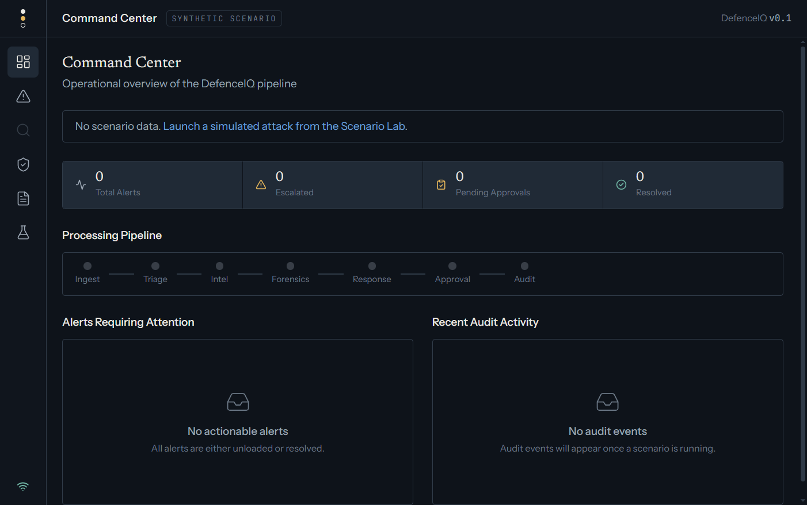
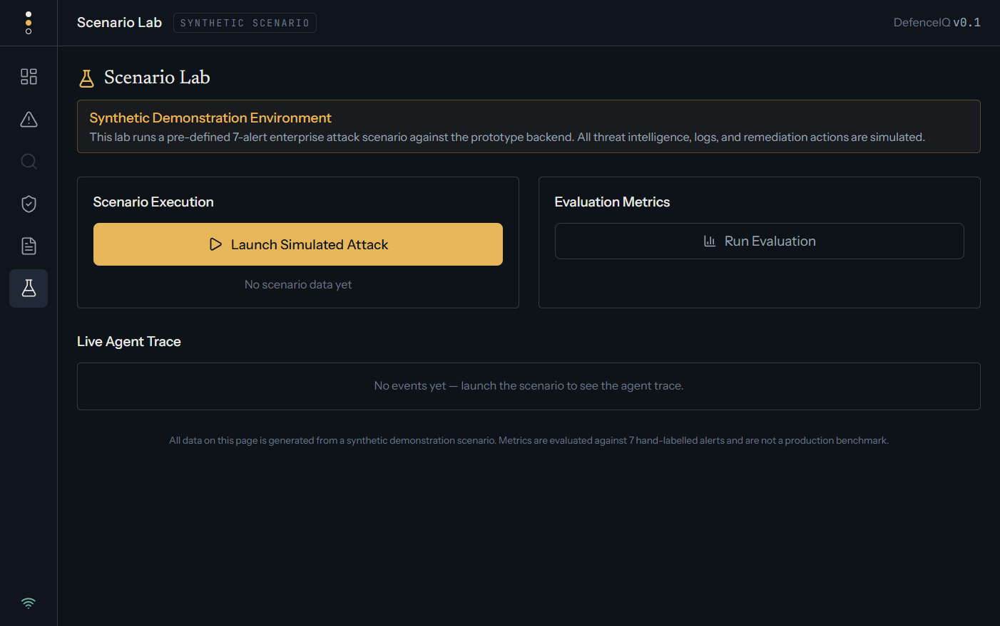
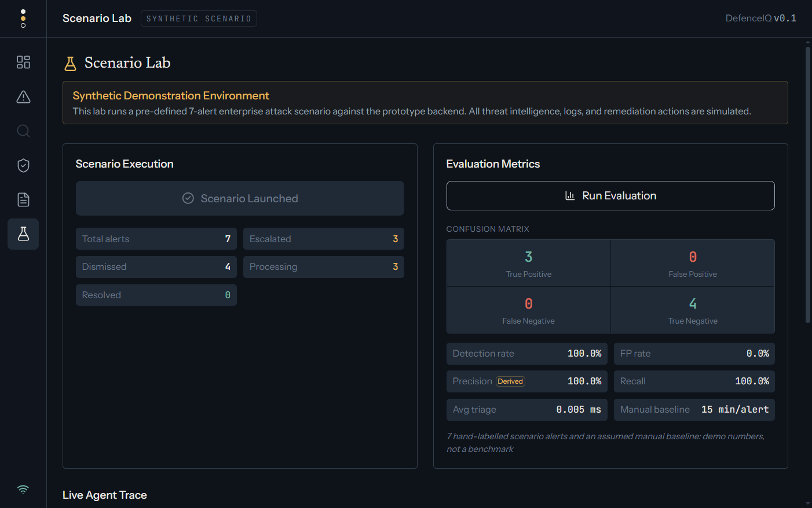
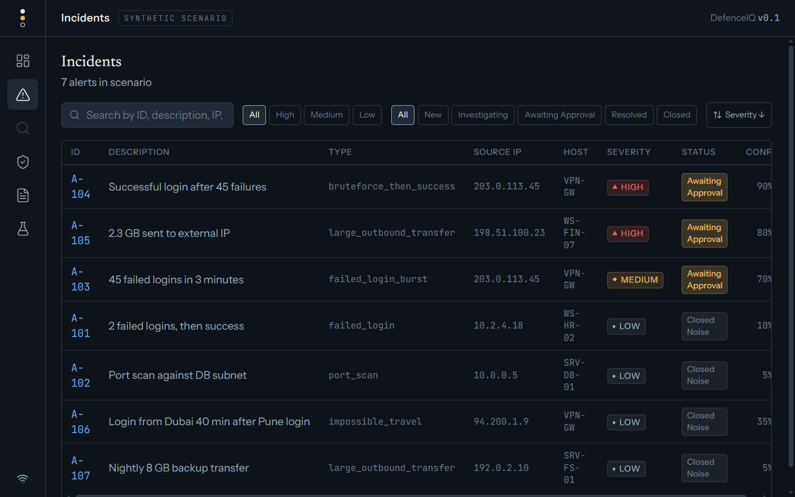
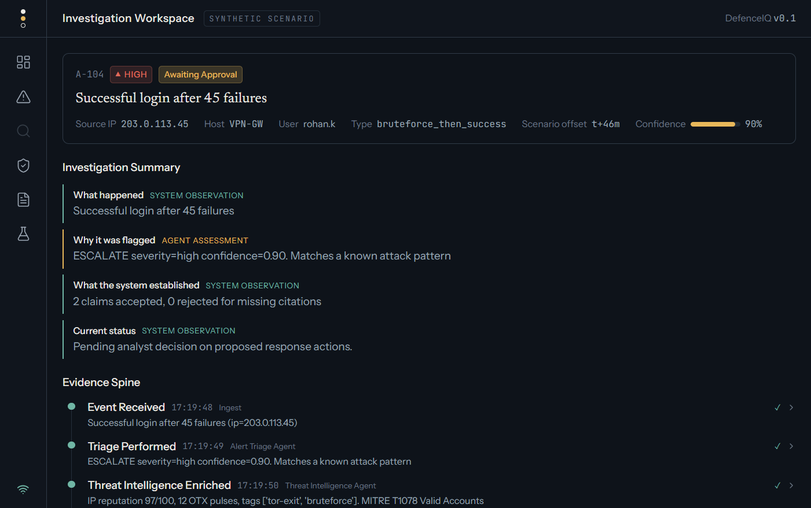
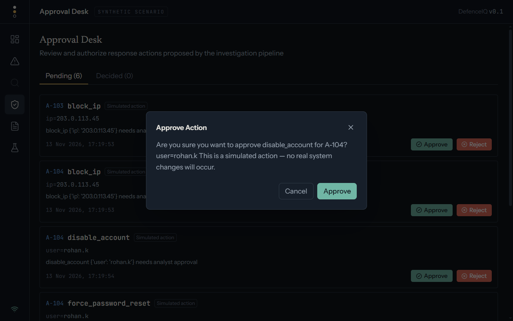
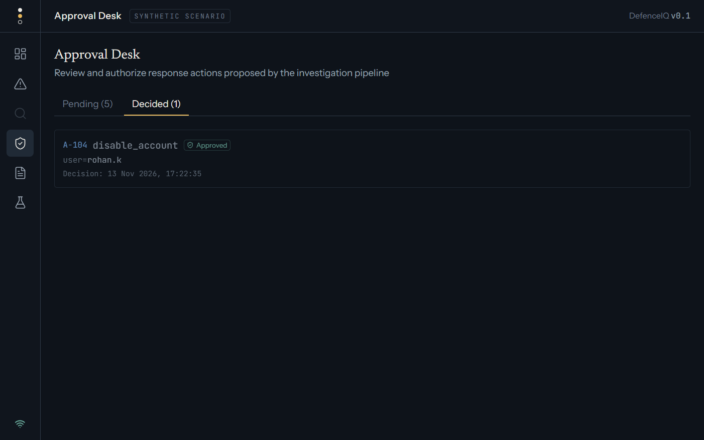
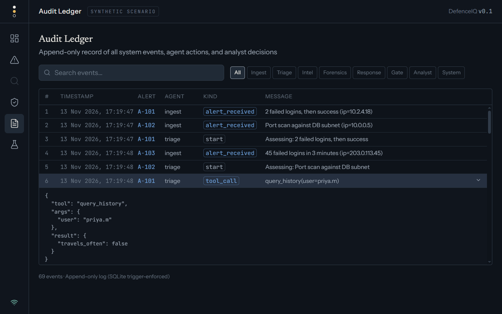
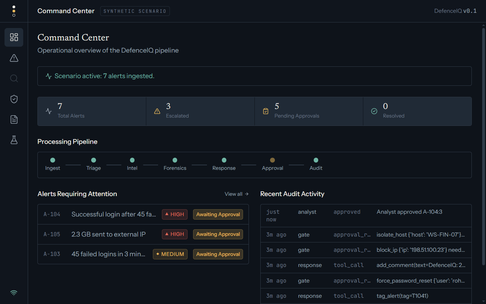

# DefenceIQ — Browser Verification & Platform Execution Walkthrough

This document records the end-to-end browser verification of the **DefenceIQ** cybersecurity platform, executed in Google Chrome at `http://localhost:5173`.

---

## Visual Verification Gallery

### 1. Command Center (Initial Idle State)
The operational landing surface prior to scenario replay. Displays the compact 7-stage processing pipeline (`Ingest → Triage → Intel → Forensics → Response → Approval → Audit`), zero-state metric cells, and live WebSocket telemetry indicator.

---

### 2. Scenario Lab (Demonstration Environment)
The demonstration console providing controlled scenario replay. Outlines the 7 enterprise attack alerts and provides execution triggers.

---

### 3. Scenario Execution & Classification Confusion Matrix
Triggered `POST /api/scenario/run` and evaluated the confusion matrix through `GET /api/eval`. Demonstrates 100% detection rate and 0% false positive rate across the synthetic baseline.

---

### 4. Incident Explorer
Structured tabular browsing of all 7 ingested security events. Shows severity levels (▲ High, ◆ Medium, ● Low), triage status, source IPs, hosts, and confidence scores.

---

### 5. Investigation Workspace & Signature Evidence Spine
Deep forensic analysis of alert `A-104` (*Successful login after 45 failures*). Highlights the signature **Evidence Spine** timeline connecting all investigation stages, the 46 cited log lines (`L001`–`L046`) in the Evidence Explorer, and the Threat Intelligence sidebar.

---

### 6. Approval Desk — Human Governance Confirmation
Human-in-the-loop decision gate displaying pending containment actions. Clicking "Approve" triggers an accessible safety confirmation modal explaining operational parameters.

---

### 7. Approval Desk — Decided View & Toast Notification
Following analyst confirmation, `POST /api/approve/A-104:3?ok=true` is submitted to the backend. The pending queue decrements, the action moves to the Decided tab, and an affirmative toast notification confirms execution.

---

### 8. Audit Ledger — Append-Only Forensic History
The immutable SQLite audit ledger recording all 69 events. Displays tool call parameters, prompt-injection quarantine events, citation validation checks, and human sign-offs with expandable JSON payloads.

---

### 9. Command Center (Active Pipeline & Updated KPIs)
Final operational state showing 7 total alerts, 3 escalated incidents, 5 pending approvals, and active pipeline indicator stages.

